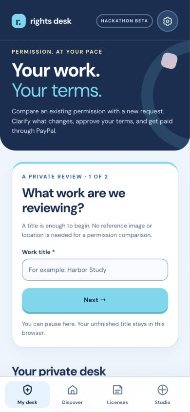
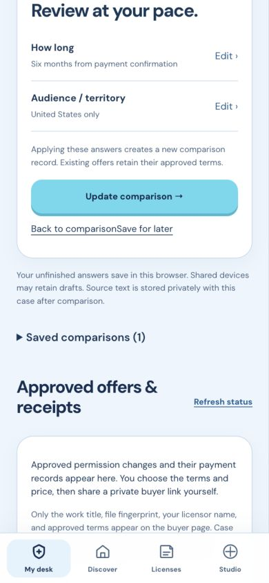

# Rights Desk

Licensed under [MIT](LICENSE).

Source: [JacquelineDMcGraw/rights-desk](https://github.com/JacquelineDMcGraw/rights-desk).

Rights Desk is a local, mobile-first **permission-change assistant for independent creators**. It compares the permission already recorded for a work with a proposed use, shows exact supporting passages, asks about missing scope, and prepares an editable change for creator review. The creator sets the fee and approves what the buyer will see. PayPal Sandbox handles checkout; a verified capture creates a receipt containing the exact approved change and its fingerprint.

The central story is **recorded permission → clear comparison → approved change → verified payment**. Original permission text, private requests, and supporting files remain in the creator's case. Optional evidence collection, named public-collection search, U.S. rights resources, and separate Studio/Discover licensing remain available.

Follow the [illustrated walkthrough](docs/WALKTHROUGH.md) to try the Harbor at Dawn Photo review, see the iPhone app, and watch the separate PayPal Sandbox checkout.





## Judge quickstart from a clean checkout

Install [Node.js 22 or newer](https://nodejs.org/en/download) and [Ollama](https://ollama.com/download). There are no npm dependencies to install. The main permission-review demo does not need ImageMagick, ExifTool, or C2PA tools; those support optional image and provenance features.

1. Start the Ollama app, or run `ollama serve` in a separate terminal. Then run `ollama pull gemma3:4b`. The tested comparison path uses this local model.
2. To enable checkout, sign in to PayPal Developer, choose **Sandbox → Apps & Credentials**, and open the default REST app or create one for a Sandbox business account. Set `PAYPAL_CLIENT_ID` and `PAYPAL_CLIENT_SECRET` from that app in the server's environment. In **Testing Tools → Sandbox Accounts**, use the separate **Personal** account for buyer sign-in. Its test login is under **⋮ → View/Edit account**. Keep both sets of credentials private. Comparison and practice are available before configuring PayPal. [PayPal REST and Sandbox setup](https://developer.paypal.com/api/rest/)
3. Open a terminal in the downloaded or cloned `rights-desk` directory. Start the app from the same terminal where you configured the Sandbox environment:

   ```sh
   export RIGHTS_DESK_KEYCHAIN=0
   npm run readiness
   npm start
   ```

   To verify the integrations separately, run `npm run verify:permissions` for a real local model comparison and `npm run verify:paypal` for Sandbox authentication without a payment. The latter requires both Sandbox credentials. For the offline regression suite, run `npm run check` and `npm test`. The tests use simulated model and payment responses and need no credentials.
4. Open [http://localhost:5188/](http://localhost:5188/) on the same computer as the server. Rights Desk binds to `127.0.0.1`, stores cases under the local `data/` directory, and uses an anonymous browser-session cookie. Keep the buyer checkout and PayPal return in the same browser session and use the same `localhost` origin. To keep a trial separate from other local cases, set `DATA_DIR` to an empty directory before `npm start`; set `PORT` if 5188 is occupied and open `http://localhost:<PORT>/` instead.

### Reproduce the permission-change example

On **My desk**, skip the optional introduction and enter **Harbor Study** as the title and **Photograph** as the work type. Select **Start private review**. The title and type are enough to start. Paste these fictional records into the two text fields.

> **Existing permission:** Harbor Studio may display the photograph Harbor Study on its own website for one year in the United States. Paid advertising and sublicensing are excluded. The creator retains copyright.
>
> **Proposed use:** Can Harbor Studio also use Harbor Study in paid social advertisements on our studio accounts for our upcoming campaign?

Select **Compare permissions** and look for the **AI comparison** badge and the quoted passages about website use and paid ads. Choose **Work through the details**, answer **six months from payment confirmation** and **United States only**, then select **Update comparison**. Choose **Review proposed change**. Use **Demo Creator** as the creator, limit the channel to **paid social advertisements on Harbor Studio’s accounts**, and enter **Credit the creator wherever the photograph appears** in **Additional conditions**. Set the fee to **$25 USD**, confirm the review checkboxes, and preview the buyer terms before approving.

For the Sandbox payment, copy the approved buyer link and open it in a separate browser session on this same computer, such as a private browser window. Enter **Harbor Studio** as the fictional buyer, accept the displayed terms and approved change, then complete checkout with your Sandbox personal account. Return to the same buyer session to see the receipt and compare the paid amount, duration, territory, and credit condition with the offer. The creator session can also find it under **Records**. This uses test funds. The optional **Translation permission** walkthrough ends at the preview.

For a faster overview, see the [2:50 demo script](docs/DEVPOST-SUBMISSION.md#250-phone-demo-script). Rights Desk is also registered in Jackie's Local Host Portal; that registration is specific to her machine and is not needed for a clean checkout.

### Record a narrated demo

Show the creator's view as you compare the two records, answer a scope question, and confirm the offer. Then show the buyer accepting those terms, completing PayPal Sandbox checkout, and returning to the receipt. Use fictional records and test funds, and start the checkout clip after the buyer signs in. To add your own voice to a slideshow, record the final slide text in order using Voice Memos or QuickTime Player (**File → New Audio Recording**). Pause briefly between slides so you can align the narration with the visuals. Keep the finished demo under three minutes.

## Learn how to use Rights Desk

A first visit with an empty desk offers a guided tour. Choose **Review a new use**, **Document possible misuse**, or **Capture an IP note** to see what you’ll need and where to start. Each path leads to guidance on the actual form. Replay the chooser from the header’s Learn (`?`) button or **How Rights Desk works** on My desk. Buyer links have their own short guide to reviewing terms, using a Personal Sandbox test account, and returning for the receipt.

**Try an example** opens **Translation permission**, a review with fictional records. You play the creator. A studio already has website permission and proposes website promotion and paid social advertisements for six months in the United States. You decide whether to allow the translation. The guide follows six lessons while leaving the actual form usable.

1. Read what was originally agreed.
2. Notice the proposed advertising use and the translation question still open.
3. Check the comparison against its supporting passages.
4. Read the studio's Spanish translation reply and explicitly review your decision.
5. Choose the additional permission, limits, and example fee.
6. Review what the buyer would see, then select **Finish review**.

The fictional studio reply asks to use a Spanish translation and offers to send it for written approval before publication. Reading that reply grants no permission. Choose to allow Spanish with your written approval, keep the work in its original language, or leave the question open. A chosen answer stays editable and needs explicit review before moving to terms. The reviewed decision carries into **Additional conditions** and the buyer preview, where you can check its exact wording. Returning to terms preserves any edits you make. Optional answer hints are fictional practice choices, not facts extracted from the original agreement or automatic agreement between the parties.

Use **Save for later** or Escape to pause, then reopen the case and choose **Step-by-step help** to resume. Help can also take a short detour to legal and technical resources, then return to the same question with its entered text preserved. **Start this review over** resets only the practice draft; saved comparison records and real reviews stay intact. Hide the spotlight when a full-page view is more helpful. Unfinished answers and guide state save in this browser, and practice can be revisited from My desk.

Both the creator review and buyer page include expandable legal and technical resources: questions to prepare, Copyright Office explanations and registration support, and a USAGov route to finding legal help. These are external resources, not an automatic referral or professional advice service.

Under **Find legal & technical help**, enter a five-digit U.S. ZIP code to look up nearby law offices. The server resolves the ZIP area using [Zippopotam.us and GeoNames](https://www.zippopotam.us/) and searches [OpenStreetMap](https://www.openstreetmap.org/copyright) for named offices. Distances are approximate. Check practice areas and licensing through the linked bar directory, or use the Copyright Claims Board’s clinic and pro bono directory. Lookup needs an internet connection. Operators can configure providers with `RIGHTS_DESK_ZIP_LOOKUP_URL` and `RIGHTS_DESK_OVERPASS_URL`.

Practice finishes at the buyer preview and explains what happens next in a real review. It creates no buyer link, PayPal order, payment, or receipt. This boundary is enforced by the server as well as the interface; practice status cannot be removed through case-detail edits. **Start my own review** begins a separate review without replacing the example or an existing case's records.

After a real Sandbox payment, open **Records** to find paid case permissions and licensed files. The case owner and that offer's recorded buyer can retrieve the stored permission receipt in their own browser sessions and download a copy. The record retains the approved scope and payment snapshot; later case edits do not rewrite it. Practice does not populate Records. This prototype has anonymous browser sessions rather than accounts, so keep checkout and the return page in the same browser and retain downloaded copies.

## Save a spoken IP note

1. Record the idea in **Voice Memos** on Apple Watch. With Voice Memos syncing through iCloud, find it in **Watch Recordings** on your iPhone. [Apple Watch Voice Memos](https://support.apple.com/en-euro/guide/watch/apd441786282/watchos)
2. Open the memo’s **More** menu on iPhone, choose **Share**, then **Save to Files**. The default export is an `.m4a` file. [Export a recording to Files](https://support.apple.com/en-ie/guide/iphone/iph831c37815/26/ios/26)
3. From **My desk → IP Notes**, choose the file and add a title. Add written context if you like. Choose a case or Studio listing, or keep **Save for a future campaign**, then select **Save private note**.
4. To attach an unassigned note later, create the campaign and return to **IP Notes**. Find the recording under **Saved notes**, select the campaign on that note, and choose **Update campaign**.

Rights Desk stores the note and audio on the local server for the browser session that saved it. A note linked to a Studio listing is visible only to its owner.

### Save an iPhone transcript with the recording

If Voice Memos offers **Copy Transcript** in the recording’s **More** menu, copy it on the iPhone. In Rights Desk, find that recording under **Saved notes** and choose **Paste transcript**. Paste the text, review it, then choose **Save transcript**. Rights Desk stores the edited text beside the recording and any written context. It does not run transcription on the server. Apple’s Voice Memos transcription depends on the device, language, and region. [View or copy a Voice Memos transcript](https://support.apple.com/en-ie/guide/iphone/iph00953a982/26/ios/26)

### Rights Desk on iPhone and Android

The **Rights Desk** mobile apps include an offline IP Notes workspace. Choose **Download language** during setup or **Skip for now** and set it up later. Import a memo from Files, transcribe it on the device, edit the text, and save the note. Setup downloads speech model files. The recognition engine runs on the phone once the model is ready.

The apps and website use separate storage. To use a mobile note in a web campaign, add the original recording to that campaign’s IP Notes on the website and paste the reviewed transcript on the saved note. The website continues to provide permission review and PayPal checkout.

- **Rights Desk on iPhone** (`org.rightsdesk.mobile`) opens **My desk** inside the app when a configured website is reachable. Tap **IP notes** to import a memo, transcribe it, edit the text, and save it beside the audio on the iPhone. Use **Back to My desk** to return to the review. If the website is unavailable, the app opens offline IP Notes and offers a retry. Open `ios/RightsDesk/RightsDesk.xcodeproj` in Xcode 26 or later, choose a development team under **Signing & Capabilities**, and run the Rights Desk target. Import and editing work on iOS 17 or later. Automatic transcription requires a compatible iPhone running iOS 26 or later with an installed Apple speech model. [Apple speech model downloads](https://developer.apple.com/documentation/speech/assetinventory)
- **Rights Desk Transcribe on iPhone** (`org.rightsdesk.transcribe`) is an optional companion for turning a Voice Memos recording into text to paste into an existing web note. Choose an `.m4a` file from Files, select the spoken language, then choose **Transcribe on this iPhone**. Review and edit the text, choose **Copy for Rights Desk**, then open the saved audio note on the website and choose **Paste transcript** or **Edit transcript**. The companion uses Apple’s SpeechAnalyzer on a compatible iPhone running iOS 26 or later and can download the required speech model on first use. Its Xcode project is `ios/RightsDeskTranscribe/RightsDeskTranscribe.xcodeproj`.
- **Android**. Open the `android/` project in Android Studio with JDK 17, Android SDK platform 35, build tools 35.0.0, NDK 27.0.12077973, and CMake 3.22.1. Select an Android 8 or later device with a supported 64-bit ABI, or build the debug APK with `cd android && ./gradlew :app:assembleDebug`. The app downloads a roughly 60 MB multilingual model on request and runs it locally using whisper.cpp. [whisper.cpp](https://github.com/ggml-org/whisper.cpp)

Transcription writes down speech in the language spoken. For example, a Spanish voice memo produces Spanish text. A request to publish a Spanish translation of a licensed work is a permission decision in the web review.

The main iPhone and Android apps import M4A, WAV, and MP3 files up to 20 MB. Automatic transcription supports recordings up to five minutes. Set `RIGHTS_DESK_WEB_URL` to a hosted HTTPS URL to launch My desk in the iPhone app. For a Debug build on the same private Wi-Fi as the local server, set `INFOPLIST_FILE=Info-Demo.plist` and point `RIGHTS_DESK_WEB_URL` to the local preview. To link to the hosted website from Android, pass `-PrightsDeskWebsiteUrl=https://your-domain.example/`.

## Compare permissions and approve a change

1. Open My desk and start a permission review with the work title and medium. An image and U.S. location are not required for this flow.
2. Paste the relevant existing permission text, or attach a contract and choose **Pull terms from contract** to fill a draft with excerpts and page references. Check the wording against the original, edit it, then choose **Save agreed terms** if you want a private reference in the case. In **Proposed use**, paste the request or attach the studio’s email or brief and choose **Pull proposed use**. Review the draft against the source before comparing.
3. Select **Compare permissions** and read the scope cards alongside their supporting passages.
4. Answer missing scope questions one at a time. You can go back, leave a question for later, or save the private draft. New scope does not silently inherit the old permission's duration or territory. Explicit unknown answers remain unresolved.
5. Review and edit the proposed purpose, channels, duration, territory, and conditions. Free-text scope supports specific terms such as six months; the flow does not replace them with a one-year default. Set the additional fee yourself. This comparison flow does not generate a market valuation or automatically calculate damages.
6. Confirm your authority and review the exact buyer preview before creating an offer. A server-generated immutable snapshot connects the approved change, original permission fingerprint, fee, work identity, and offer. Re-running the comparison or changing case notes cannot rewrite that offer.
7. Share the buyer link yourself. The buyer sees approved terms and fingerprints, without the original permission text, private request, comparison passages, or supporting files. The buyer accepts the exact terms version and approved-change fingerprint before PayPal checkout.
8. After PayPal confirms the exact order, offer reference, USD amount, and capture, the case and buyer receive the same permission-change receipt. No payment is simulated when credentials or approval are missing. A paid change covers its stated permission; it does not determine infringement or settle earlier use.

The sample-wording control fills editable fictional text for trying the comparison.

Contract reading runs locally and supports PDFs up to 20 pages and JPEG or PNG attachments up to 10 MB. It uses Swift and PDFKit on macOS or Poppler on other systems. Scanned pages and images also need Tesseract. If a file is unreadable or the local reader is unavailable, paste the relevant wording instead.

The same local reader can pull a proposed use from those formats. Permission reviews also accept `.eml` email files and UTF-8 `.txt` files. Reading `.eml` uses Python 3 and reads the message body. Attach a brief separately if the studio included it as an email attachment.

### How the permission comparison AI works

Suppose your agreement lets Harbor Diner use your photograph on its printed menus and excludes paid advertising. A few weeks later the owner emails asking to put the same photo in a paid commercial. Put the menu agreement in **Existing permission** and the owner’s email in **Proposed use**. Review the wording first if you pulled it from an uploaded file.

1. **Read both sources.** When you select **Compare permissions**, the server sends the two text fields and comparison instructions to Ollama. By default, Google’s Gemma 3 4B (`gemma3:4b`) runs on the computer hosting Rights Desk. If you change `OLLAMA_URL`, the reviewed wording goes to that endpoint instead. The uploaded files, account credentials, and your follow-up answers stay out of that call.
2. **Compare the scope and show the wording.** The model reads each text independently and returns structured JSON covering purpose, channels, duration, and territory. For each detail it provides an assessment (**changed**, **consistent**, or **unclear**) and a short quote from each source when available. In the diner example, the model can point to “printed menus” and “paid commercial” as evidence of a possible channel change. The server checks the response format and looks for each quote in its corresponding text, normalizing whitespace and quotation marks. If a quote cannot be found, the server drops it and marks that comparison unclear. A quote confirms where the wording came from. You still decide what the wording means for your agreement.
3. **Ask about missing details.** If the commercial request leaves out the run dates or distribution area, the app asks you to fill those in. The model’s suggestion for a detail needs a quote from the proposed use. Your own clarification takes priority, and you can save the draft and come back later. If Ollama is unavailable or returns an invalid response, the app shows **Manual review · AI unavailable** and lets you supply the scope yourself.
4. **Set your terms and fee.** You decide whether to grant commercial use, where and for how long, and what to charge. The AI’s role ends with the comparison and suggested scope. You review the exact buyer terms before creating the offer. PayPal Sandbox handles payment, and the receipt records the specific change the buyer accepted.

Run `npm run verify:permissions` with Ollama running to check a real model response. The comparison UI shows **AI comparison** when the server records `aiMode: "ollama"`. See the [comparison implementation](lib/permission-comparison.mjs).

## Optional evidence case workflow

The case intake presents one question at a time. Every question can be left for later, Back returns to the previous answer, and Review answers lets you jump directly to any question. Save for later preserves your place and answers in this browser; the selected image is retained in IndexedDB when supported. If browser storage is unavailable, the page explains what will need to be reselected. A saved server case needs the reference image, title, medium, use channel, and location; optional details can wait.

After a case is created, Update case details lets you revisit the same questions and add or correct facts. Each case has its own unfinished edit draft. The original reference and fingerprint stay fixed, and previously approved offers retain their original work description and terms.

The spotlight tour is optional inside the evidence-case section. When you choose it, it highlights the relevant question, then resumes after creation with public search, evidence, licensing, the location guide, and summary export. You can skip or replay either phase.

## Appearance preferences

Open Settings from the header gear to choose Graffiti, Sky, Caramel Latte, Sage, Midnight, or High Contrast. Graffiti is the fresh/default palette: asphalt `#121214`, dark `#1C1C21` cards, chalk text, and cyan, yellow, magenta, and orange accents. Reference-inspired sticker borders give it character while forms and guidance retain clean, readable text. Sky keeps the earlier navy and icy blue style, and Caramel Latte retains the supplied DaisyUI tokens as standard CSS variables, without adding a build dependency. Semantic roles keep forms, offers, status messages, navigation, and the tutorial consistent across palettes. Explicit saved choices remain respected and apply before the page paints; changing palettes preserves unsaved form inputs. Use default palette returns to Graffiti.

## Case steps

1. Create a private case with a reference image or screenshot, work type, suspected use channel, and U.S. location. Additional fields record your ownership basis, publication date, registration number, and reported URL.
2. Search Openverse, Wikimedia Commons, and Library of Congress public collections. Rights Desk sends text search terms to those catalogs, then compares your image locally with a small sample of returned thumbnails. If Ollama `gemma3:4b` is available, it may create local visual search terms. The uploaded image and documents are **not** sent to public providers.
3. Read the coverage report. It names each source searched or unavailable, the number of candidates returned and compared, visual leads, source links, and limitations. This is a **sampled keyword discovery process**, not a web-wide reverse image search. A match cannot prove ownership, licensing, infringement, or AI training. A miss only means no lead in the sources checked.
4. Add private PDF/JPEG/PNG supporting records when results are absent or uncertain. The document checklist varies for photographs, illustration, video, writing, music, and mixed AI work. Download a case summary for review.
5. Follow official starting points for U.S. copyright, registration, online notices, the Copyright Claims Board, and legal help. The selector covers all 50 states, D.C., Puerto Rico, U.S. Virgin Islands, Guam, Northern Mariana Islands, American Samoa, and nine named minor outlying islands. Every place has local issue prompts for publicity/likeness, privacy, and contracts with an official source link. Specific rules are stated only when verified; otherwise the app says a local-law review is needed. The local source snapshot is dated October 25, 2026 and is not a complete survey of each place's law. American Samoa gets a separate caution because the Copyright Office identifies different federal coverage there. The guide and sources are also included in the downloaded case summary.
6. If you control the relevant rights and want to offer permission, describe a specific licensed use and your base rate. The optional local AI classifies usage, duration, and territory; fixed factors calculate a suggested price. Review every field and assumption before approving an offer. Creating a case or finding a visual lead never creates an offer automatically.
7. Copy the approved offer link yourself. The buyer view contains the work title and fingerprint, licensor, licensed use, scope, price, expiry, and offer note. It excludes the private reference image, case story, reported URL, and supporting files. Treat anything entered into an offer as information its link holder can read. Localhost links work only on the machine running the app; this build does not send messages or contact the suspected user.
8. In the buyer view, enter the licensee name, review the exact terms, and continue to PayPal Sandbox. The server checks the returned order, capture status, USD amount, and offer reference before recording a paid license receipt. The buyer and case owner can read the receipt. Offers expire after seven days and can be revoked before payment; paid receipts remain in the case. A case offer records scoped permission and payment, without delivering the private case evidence or an original media file. The separate Studio listing flow handles paid file delivery.

Case files remain on this local machine under `data/` and are accessible only through the anonymous browser session. They are not shown in the public collection. The server records a SHA-256 digest of each uploaded case image to help identify that exact local file later; the digest does not prove who created it. This is a prototype without user accounts or a production-grade backup/recovery system; keep your originals and records elsewhere too.

## Optional integrations

For real **Sandbox** checkout, provide `PAYPAL_CLIENT_ID` and `PAYPAL_CLIENT_SECRET` in the server environment. On Jackie's Mac, `npm start` and the verification commands also load the pair from macOS Keychain when neither environment value is set. The account is `JacquelineDMcGraw`; the services are `codex.rights-desk.paypal_sandbox_client_id` and `codex.rights-desk.paypal_sandbox_client_secret`. Only references belong in source or the local secret registry. Never put actual credential values in the repository, including ignored files. A partial environment pair is not mixed with Keychain values. Set `RIGHTS_DESK_KEYCHAIN=0` to disable lookup; CI and regression tests do not read Keychain.

Use an existing or new PayPal Developer **Sandbox** app and a separate Sandbox **personal buyer** account. Run `npm run verify:paypal` to verify OAuth authentication without creating an order or payment; it prints only safe status information. Restart the server after changing stored credentials. Rights Desk obtains an OAuth token, creates an Orders v2 order, sends the buyer to PayPal for approval, and captures the order on return. A case-offer receipt or listing download is issued only after the server verifies a completed capture for the exact scope reference and price. With no credentials, checkout returns HTTP 503 and no license is issued. The app never simulates a successful payment.

The older evidence-case offer and Studio listing quote flows also use Ollama with `gemma3:4b`. Those flows classify usage, term, and territory and use fixed seller-side multipliers to calculate a price. They fall back to explicit rules, marked `aiMode: "rules"` in the API/UI. In the [permission comparison flow](#how-the-permission-comparison-ai-works), you set the price yourself.

```sh
ollama serve
ollama pull gemma3:4b
npm start
```

Run `ollama serve` in its own terminal if the Ollama app is not already serving. See [HACKATHON.md](HACKATHON.md) for the complete judge demo setup and [the submission draft](docs/DEVPOST-SUBMISSION.md) for the short demo script.

`exiftool` and `c2patool` can strengthen the origin inspection when installed. Evidence indicators are not proof that a photograph was camera-captured. Camera claims remain pending review unless a trusted server-side human-review record is present. Uploader requests cannot submit that record.

## API

| Route | Purpose |
| --- | --- |
| `GET /api/status` | PayPal Sandbox and local model availability |
| `POST /api/cases`, `GET /api/cases`, `GET /api/cases/:id` | Create and read session-private rights cases |
| `POST /api/permission-cases` | Start a permission review with `{title, workType, practice?}`; optional `practice` is a boolean and defaults to false. Practice cases cannot create offers or payments; no reference image is required |
| `GET /api/cases/:id/permission-comparisons`, `POST /api/cases/:id/permission-comparisons` | Read private comparisons or compare `{permissionText, requestText, answers}` |
| `POST /api/cases/:id/permission-comparisons/:comparisonId/offer` | Approve reviewed scope and creator-set fee as an immutable permission-change offer |
| `POST /api/cases/:id/details` | Update owner-provided case facts while preserving the reference and evidence |
| `POST /api/cases/:id/search`, `GET /api/cases/:id/search-results` | Search named public collections and read coverage/evidence |
| `POST /api/cases/:id/documents`, `GET /api/cases/:id/documents` | Add/read private supporting-file metadata |
| `GET /api/cases/:id/documents/:docId/download` | Download a document from its owner session |
| `POST /api/cases/:id/offer-draft` | Classify `{request, basePrice}` and suggest a scope/price for owner review |
| `POST /api/cases/:id/offers`, `GET /api/cases/:id/offers` | Approve and read the owner's case license offers |
| `POST /api/cases/:id/offers/:offerId/revoke` | Revoke an unpaid offer |
| `GET /api/offers/:token` | Read the limited buyer view for a shared offer |
| `POST /api/offers/:token/checkout` | Start Sandbox checkout after `{licenseeName, acceptedTerms:true, termsVersion}`; permission changes also require `acceptedChangeHash` |
| `POST /api/offers/:token/orders/:orderId/capture` | Verify payment and create the scoped license receipt |
| `GET /api/offers/:token/receipt?orderId=…` | Read a paid receipt from its buyer or case-owner session |
| `GET /api/case-receipts` | List immutable paid case receipts for the case owner or that offer's buyer session, newest first; excludes practice and private case inputs |
| `GET /api/listings`, `GET /api/listings/:id` | Public photos and evidence summary |
| `POST /api/uploads?kind=preview\|source` | Raw image bytes; preview 12 MiB max, source 32 MiB max |
| `POST /api/listings` | Create listing with title, artist, story, declaration, both upload IDs, and basePrice |
| `POST /api/listings/:id/inspect` | Inspect the uploader's evidence |
| `POST /api/listings/:id/quote` | Interpret `{ "request": "…" }` and return a fixed-price license quote |
| `POST /api/checkout` | Create a PayPal Sandbox order from `{ "quoteId": "…" }` |
| `POST /api/checkout/:orderId/capture` | Confirm completed PayPal capture and issue a license |
| `GET /api/licenses` | Licenses for this browser session |
| `GET /api/download/:licenseToken` | Private source file after completed capture |

The local prototype uses an anonymous browser session cookie. Names are self-entered; the app does not authenticate a creator's ownership or a buyer's identity. An offer is voluntary permission for the stated scope, and does not determine infringement, release earlier claims, or resolve a legal dispute. The prototype does not include user accounts, multi-seller payment routing, moderation, dispute resolution, or production payment webhooks. The configured Sandbox merchant receives test payments; this is not a payout marketplace.

## Verification

Run the syntax checks, regression tests, availability report, and real model inference check:

```sh
npm run check
npm test
npm run readiness
npm run verify:ai
npm run verify:permissions
npm run verify:paypal
```

The integration tests use isolated temporary data and mocked PayPal/model responses. They verify privacy, versioned term acceptance, checkout, capture validation, retry recovery, receipt issuance, and explicit-scope preservation. The onboarding-practice suite also checks immutable practice status, working private comparisons, blocked practice offers and payments before the payment transport is called, normal checkout outside practice, and owner/buyer/stranger privacy for saved case receipts. Credential-loading tests inject a fake reader to verify source isolation and atomic loading without accessing Keychain. `readiness` reports installed/configured integrations without claiming inference or capture. `verify:ai` sends an actual scope request to the configured local model and checks its result. `verify:paypal` contacts PayPal Sandbox for authentication only.

The new permission-change flow completed an actual **$25 PayPal Sandbox payment** on November 5, 2026 Eastern for the fictional Harbor Study review. A real `ollama` comparison identified the website-to-paid-Instagram change; creator clarifications set six months and United States distribution. The paid case, payment order, and receipt retain identical approved scope, fee, terms, and change fingerprints. See the [change receipt screenshot](docs/permission-change-payment-sky.png), [synthetic verification record](docs/permission-change-verification.json), and [verification notes](docs/VERIFICATION.md). The earlier voluntary-license payment remains separately recorded. The public demo video remains to be recorded.

GitHub Actions runs the syntax checks and mock regression suite on pushes and pull requests using Node.js 22. It requires no PayPal or model credentials.

See [PITCH.md](PITCH.md) for the sourced hackathon framing, including Getty Images Holdings' October 2026 Chapter 11 filing and why that filing should not be attributed to AI without evidence.

See [HACKATHON.md](HACKATHON.md) for a judge setup path, a three-minute demo outline, and the remaining publication requirements from the supplied hackathon rules.

## References

- [PayPal REST authentication](https://developer.paypal.com/api/rest/authentication)
- [PayPal Checkout integration](https://developer.paypal.com/platforms/checkout/standard/integrate)
- [Ollama structured outputs](https://ollama.com/blog/structured-outputs)
- [U.S. Copyright Office, copyright basics](https://www.copyright.gov/what-is-copyright/)
- [U.S. Copyright Office, Section 512 notice guidance](https://www.copyright.gov/512/)
- [U.S. Copyright Office, territorial coverage](https://www.copyright.gov/circs/circ38a.pdf)
