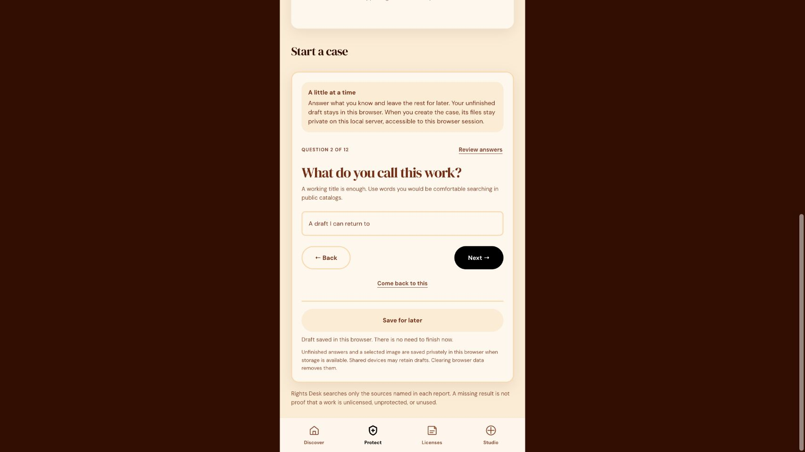
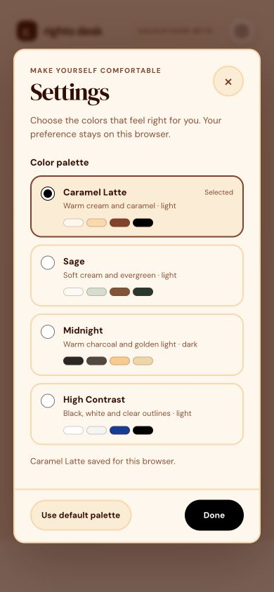
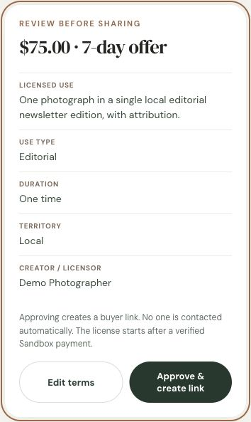

# Rights Desk

Licensed under [MIT](LICENSE).

Development source: [JacquelineDMcGraw/rights-desk](https://github.com/JacquelineDMcGraw/rights-desk). The repository is private at the creator's request; hackathon publication remains a separate step.

Rights Desk is a local, mobile-first prototype that takes a U.S. creator from **proof to permission to payment**. In **Protect**, a creator opens a private case, searches named public image collections for visual leads, stores supporting documents, and follows a U.S. rights guide by work type, use channel, and jurisdiction. From that case, the creator can review an AI-assisted scope draft, approve a voluntary license offer, and share its buyer link. A verified PayPal Sandbox capture creates a receipt in the case. **Studio** and **Discover** also support public image listings with a private source-file download after verified payment.







## Run locally

Requires Node.js 22 or newer. No package install is needed. `magick` (ImageMagick) enables visual thumbnail comparison; `exiftool` and `c2patool` improve provenance inspection. The app reports unavailable checks rather than inventing results.

```sh
npm start
```

Open [http://localhost:5188/](http://localhost:5188/). The server binds only to `127.0.0.1` and writes its data into `data/`. To run isolated QA without changing project data, set `DATA_DIR=/private/tmp/rights-desk-qa` and `PORT=5189` before starting. Rights Desk is also registered in Jackie's Local Host Portal.

## Protect workflow

The case intake presents one question at a time. Every question can be left for later, Back returns to the previous answer, and Review answers lets you jump directly to any question. Save for later preserves your place and answers in this browser; the selected image is retained in IndexedDB when supported. If browser storage is unavailable, the page explains what will need to be reselected. A saved server case needs the reference image, title, medium, use channel, and location; optional details can wait.

After a case is created, Update case details lets you revisit the same questions and add or correct facts. Each case has its own unfinished edit draft. The original reference and fingerprint stay fixed, and previously approved offers retain their original work description and terms.

The spotlight tour is optional from the Protect header. When you choose it, it highlights the relevant question, then resumes after creation with public search, evidence, licensing, the location guide, and summary export. You can skip or replay either phase.

## Appearance preferences

Open Settings from the header gear to choose Caramel Latte, Sage, Midnight, or High Contrast. Caramel Latte uses the supplied DaisyUI color, radius, and border tokens as standard CSS variables, without adding a build dependency. Semantic roles keep the forms, offers, status messages, navigation, and tutorial consistent across palettes. The choice saves locally and is applied before the page paints; changing it preserves unsaved form inputs. Use default palette returns to Caramel Latte.

## Case steps

1. Create a private case with a reference image or screenshot, work type, suspected use channel, and U.S. location. Additional fields record your ownership basis, publication date, registration number, and reported URL.
2. Search Openverse, Wikimedia Commons, and Library of Congress public collections. Rights Desk sends text search terms to those catalogs, then compares your image locally with a small sample of returned thumbnails. If Ollama `gemma3:4b` is available, it may create local visual search terms. The uploaded image and documents are **not** sent to public providers.
3. Read the coverage report. It names each source searched or unavailable, the number of candidates returned and compared, visual leads, source links, and limitations. This is a **sampled keyword discovery process**, not a web-wide reverse image search. A match cannot prove ownership, licensing, infringement, or AI training. A miss only means no lead in the sources checked.
4. Add private PDF/JPEG/PNG supporting records when results are absent or uncertain. The document checklist varies for photographs, illustration, video, writing, music, and mixed AI work. Download a case summary for review.
5. Follow official starting points for U.S. copyright, registration, online notices, the Copyright Claims Board, and legal help. The selector covers all 50 states, D.C., Puerto Rico, U.S. Virgin Islands, Guam, Northern Mariana Islands, American Samoa, and nine named minor outlying islands. Every place has local issue prompts for publicity/likeness, privacy, and contracts with an official source link. Specific rules are stated only when verified; otherwise the app says a local-law review is needed. The local source snapshot is dated October 25, 2026 and is not a complete survey of each place's law. American Samoa gets a separate caution because the Copyright Office identifies different federal coverage there. The guide and sources are also included in the downloaded case summary.
6. If you control the relevant rights and want to offer permission, describe a specific licensed use and your base rate. The optional local AI classifies usage, duration, and territory; fixed factors calculate a suggested price. Review every field and assumption before approving an offer. Creating a case or finding a visual lead never creates an offer automatically.
7. Copy the approved offer link yourself. The buyer view contains the work title and fingerprint, licensor, licensed use, scope, price, expiry, and offer note. It excludes the private reference image, case story, reported URL, and supporting files. Treat anything entered into an offer as information its link holder can read. Localhost links work only on the machine running the app; this build does not send messages or contact the suspected user.
8. In the buyer view, enter the licensee name, review the exact terms, and continue to PayPal Sandbox. The server checks the returned order, capture status, USD amount, and offer reference before recording a paid license receipt. The buyer and case owner can read the receipt. Offers expire after seven days and can be revoked before payment; paid receipts remain in the case. A case offer records scoped permission and payment, without delivering the private case evidence or an original media file. The separate Studio listing flow handles paid file delivery.

Case files remain on this local machine under `data/` and are accessible only through the anonymous browser session. They are not shown in the public collection. The server records a SHA-256 digest of each uploaded case image to help identify that exact local file later; the digest does not prove who created it. This is a prototype without user accounts or a production-grade backup/recovery system; keep your originals and records elsewhere too.

## Optional integrations

For real **Sandbox** checkout, set `PAYPAL_CLIENT_ID` and `PAYPAL_CLIENT_SECRET` in the server environment. You can create a local `.env` from `.env.example` and run `node --env-file=.env server.mjs`; `.env` is ignored by Git. Use a PayPal Developer Sandbox app and a Sandbox personal buyer account. Rights Desk obtains an OAuth token, creates an Orders v2 order, sends the buyer to PayPal for approval, and captures the order on return. A case-offer receipt or listing download is issued only after the server verifies a completed capture for the exact scope reference and price. With no credentials, checkout returns HTTP 503 and no license is issued. The app never simulates a successful payment.

For AI-assisted interpretation of licensed-use requests, run Ollama locally with `gemma3:4b` available. The model classifies usage, term, and territory through a JSON schema for both case-offer drafts and listing quotes. Fixed seller-side multipliers calculate the price. If Ollama is unavailable or invalid, explicit rules produce the quote, marked `aiMode: "rules"` in the API/UI. Rules do not impersonate model output. Check `GET /api/status` before recording a demo, then confirm the actual draft returns `aiMode: "ollama"`; availability alone does not establish that a particular request used the model.

```sh
ollama serve
ollama pull gemma3:4b
node --env-file=.env server.mjs
```

Run `ollama serve` in its own terminal if the Ollama app is not already serving. See [HACKATHON.md](HACKATHON.md) for the complete judge demo setup and [the submission draft](docs/DEVPOST-SUBMISSION.md) for the short demo script.

`exiftool` and `c2patool` can strengthen the origin inspection when installed. Evidence indicators are not proof that a photograph was camera-captured. Camera claims remain pending review unless a trusted server-side human-review record is present. Uploader requests cannot submit that record.

## API

| Route | Purpose |
| --- | --- |
| `GET /api/status` | PayPal Sandbox and local model availability |
| `POST /api/cases`, `GET /api/cases`, `GET /api/cases/:id` | Create and read session-private rights cases |
| `POST /api/cases/:id/details` | Update owner-provided case facts while preserving the reference and evidence |
| `POST /api/cases/:id/search`, `GET /api/cases/:id/search-results` | Search named public collections and read coverage/evidence |
| `POST /api/cases/:id/documents`, `GET /api/cases/:id/documents` | Add/read private supporting-file metadata |
| `GET /api/cases/:id/documents/:docId/download` | Download a document from its owner session |
| `POST /api/cases/:id/offer-draft` | Classify `{request, basePrice}` and suggest a scope/price for owner review |
| `POST /api/cases/:id/offers`, `GET /api/cases/:id/offers` | Approve and read the owner's case license offers |
| `POST /api/cases/:id/offers/:offerId/revoke` | Revoke an unpaid offer |
| `GET /api/offers/:token` | Read the limited buyer view for a shared offer |
| `POST /api/offers/:token/checkout` | Start Sandbox checkout after `{licenseeName, acceptedTerms:true, termsVersion}` from the reviewed offer |
| `POST /api/offers/:token/orders/:orderId/capture` | Verify payment and create the scoped license receipt |
| `GET /api/offers/:token/receipt?orderId=…` | Read a paid receipt from its buyer or case-owner session |
| `GET /api/listings`, `GET /api/listings/:id` | Public photos and evidence summary |
| `POST /api/uploads?kind=preview\|source` | Raw image bytes; preview 12 MiB max, source 32 MiB max |
| `POST /api/listings` | Create listing with title, artist, story, declaration, both upload IDs, and basePrice |
| `POST /api/listings/:id/inspect` | Inspect the uploader's evidence |
| `POST /api/listings/:id/quote` | Interpret `{ "request": "…" }` and return a fixed-price license quote |
| `POST /api/checkout` | Create a PayPal Sandbox order from `{ "quoteId": "…" }` |
| `POST /api/checkout/:orderId/capture` | Confirm completed PayPal capture and issue a license |
| `GET /api/licenses` | Licenses for this browser session |
| `GET /api/download/:licenseToken` | Private source file after completed capture |

The local prototype uses an anonymous browser session cookie. Names are self-entered; the app does not authenticate a creator's ownership or a buyer's identity. An offer is voluntary permission for the stated scope, and does not determine infringement, release earlier claims, or resolve a legal dispute. The prototype does not include user accounts, multi-seller payment routing, moderation, dispute resolution, or production payment webhooks. The configured Sandbox merchant receives test payments; this is not a payout marketplace.

## Verification

Run the syntax checks, regression tests, availability report, and real model inference check:

```sh
npm run check
npm test
npm run readiness
npm run verify:ai
```

The integration tests use isolated temporary data and mocked PayPal/model responses. They verify privacy, versioned term acceptance, checkout, capture validation, retry recovery, receipt issuance, and explicit-scope preservation. `readiness` reports installed/configured integrations without claiming inference or capture. `verify:ai` sends an actual scope request to the configured local model and checks its result. A real PayPal Sandbox approval/capture still needs to be demonstrated separately before recording the successful payment sequence.

GitHub Actions runs the syntax checks and mock regression suite on pushes and pull requests using Node.js 22. It requires no PayPal or model credentials.

See [PITCH.md](PITCH.md) for the sourced hackathon framing, including Getty Images Holdings' October 2026 Chapter 11 filing and why that filing should not be attributed to AI without evidence.

See [HACKATHON.md](HACKATHON.md) for a judge setup path, a three-minute demo outline, and the remaining publication requirements from the supplied hackathon rules.

## References

- [PayPal REST authentication](https://developer.paypal.com/api/rest/authentication)
- [PayPal Checkout integration](https://developer.paypal.com/platforms/checkout/standard/integrate)
- [Ollama structured outputs](https://ollama.com/blog/structured-outputs)
- [U.S. Copyright Office, copyright basics](https://www.copyright.gov/what-is-copyright/)
- [U.S. Copyright Office, Section 512 notice guidance](https://www.copyright.gov/512/)
- [U.S. Copyright Office, territorial coverage](https://www.copyright.gov/circs/circ38a.pdf)
