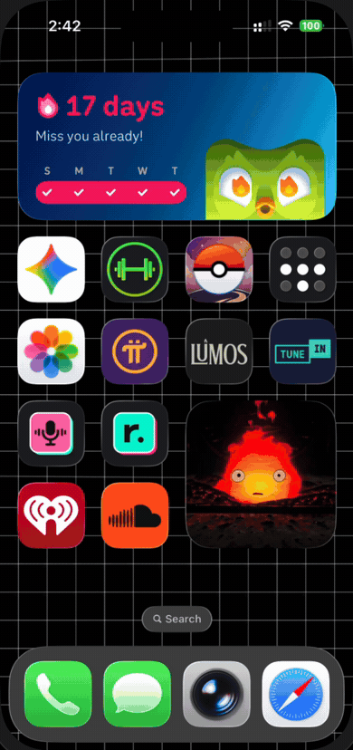
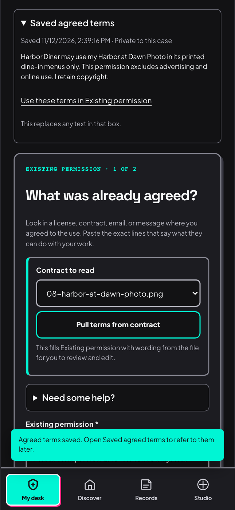
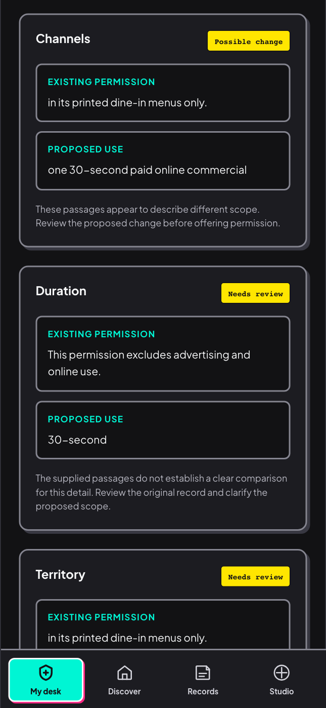
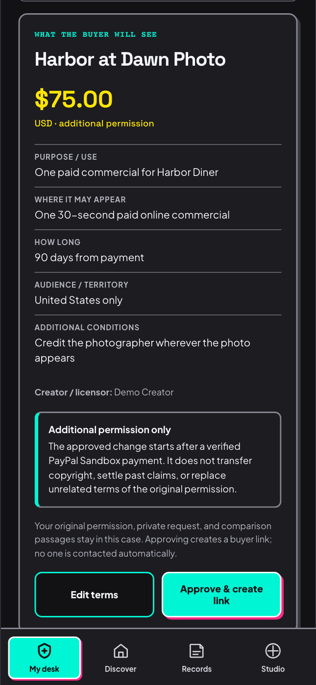
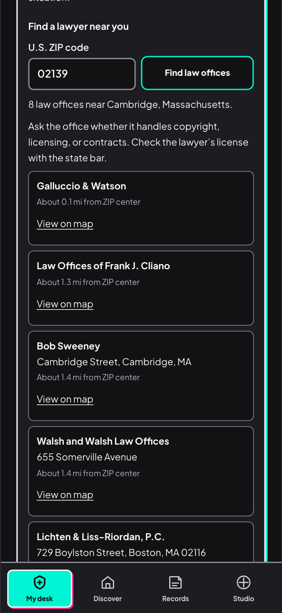
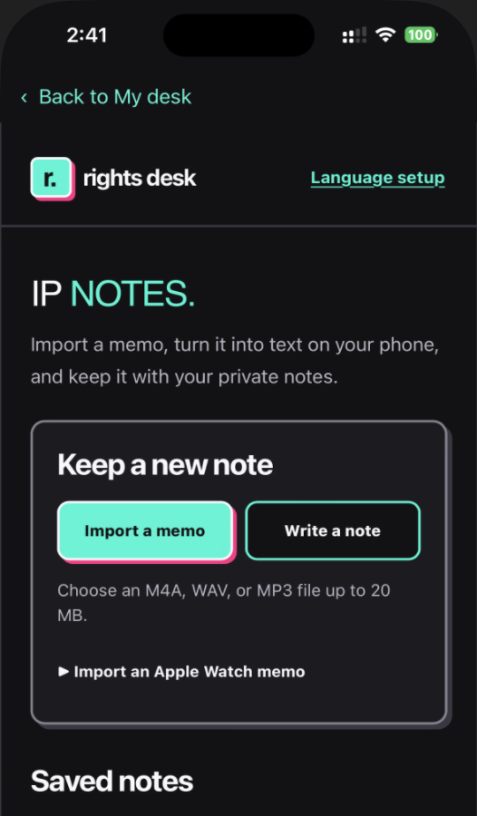

# Rights Desk walkthrough

Harbor Diner has permission to use **Harbor at Dawn Photo** on its printed menus. Later, the diner asks to use it in a paid online commercial. Follow the review as the photographer compares the two uses, decides what to allow, and previews the offer the diner would see.

## Open My desk

Start the web server and Ollama using the [quickstart](../README.md#judge-quickstart-from-a-clean-checkout). Use a fresh browser session for an empty desk, or build and open the [Rights Desk iPhone app](../README.md#rights-desk-on-iphone-and-android) with a reachable server URL. On iPhone, tap the **Rights Desk** icon to open **My desk**. If you see the guided tour, choose **Skip tour** to follow the steps below.

## Record the menu permission

1. Open **My desk → Start a permission review**. Choose **Use example title: Harbor at Dawn Photo**, then **Next → Photograph → Start private review**.
2. On **Existing permission**, open **Start from a template** and choose **Load Harbor at Dawn Photo example**. This fills both source fields with editable text. You can also paste text or attach a source and review the extracted wording.
3. Check the original permission and select **Save agreed terms**. Rights Desk keeps it as a private reference for this review.

> Harbor Diner may use my Harbor at Dawn Photo in its printed dine-in menus only. This permission excludes advertising and online use. I retain copyright.

To follow the upload in the demo, download the AI-generated [Harbor at Dawn Photo](walkthrough/08-harbor-at-dawn-photo.png) and add it under **Supporting records**.

## Compare the commercial request

1. Choose **Next** to open **Proposed use** and check the diner’s request.

   > Can Harbor Diner use Harbor at Dawn Photo in one 30-second paid online commercial?

2. Select **Compare permissions**. Check the supporting wording in the **Existing permission** and **Proposed use** columns. With the local model running, the **AI comparison** badge identifies the model-assisted result. If the model is unavailable, the app labels the comparison **Manual review**.
3. Select **Work through the details**. Enter **90 days from payment** and **United States only** for the open duration and territory questions. If asked about purpose or placement, enter **One paid commercial for Harbor Diner** and **One 30-second paid online commercial**. Review the answers and select **Update comparison**.

## Preview the diner’s offer

Choose **Review proposed change**. Enter **Demo Creator** as the licensor, confirm the purpose, placement, duration, and territory, and add **Credit the photographer wherever the photo appears** under **Additional conditions**. Set the fee to **$75 USD**. Check the review boxes and choose **Preview buyer offer**.

The preview shows the additional permission the buyer can accept. For a Sandbox checkout, select **Approve & create link**, open the buyer link in a separate browser session, and use the buyer’s Personal Sandbox test account. After PayPal confirms capture, the app saves a receipt with the accepted scope, fee, and change fingerprint. See the [Sandbox setup](../README.md#judge-quickstart-from-a-clean-checkout).

### A recorded $25 Sandbox checkout

The [checkout and receipt clip](walkthrough/07-paypal-sandbox.mp4) shows a separate, completed **$25 PayPal Sandbox** transaction for a fictional paid Instagram use. The $75 Harbor Diner offer above is a preview. The [receipt screenshot](permission-change-payment-sky.png) and [verification record](permission-change-verification.json) document the completed Sandbox transaction, which used test funds.

## Find legal and technical help

Open **Find legal & technical help** in the creator review or buyer view. Under **Find a lawyer near you**, enter a five-digit U.S. ZIP code such as **02139** and choose **Find law offices**. The app shows nearby offices found in public map listings, with approximate distances from the ZIP area. Ask whether the office handles copyright, licensing, or contracts. The bar directory and copyright clinic links give you another place to look, including when no offices appear for your ZIP.

## Capture an IP note on iPhone

From **My desk**, tap **IP notes** to open the on-device workspace. Choose **Import a memo**, select an audio file from Files, and choose **Transcribe on this phone** after the speech language has been downloaded. Edit the transcript and save it with the audio. Tap **Back to My desk** to return to the permission review. The iPhone app can open offline IP Notes if the server is unavailable. For browser campaign notes and Android setup, see [Save a spoken IP note](../README.md#save-a-spoken-ip-note).

